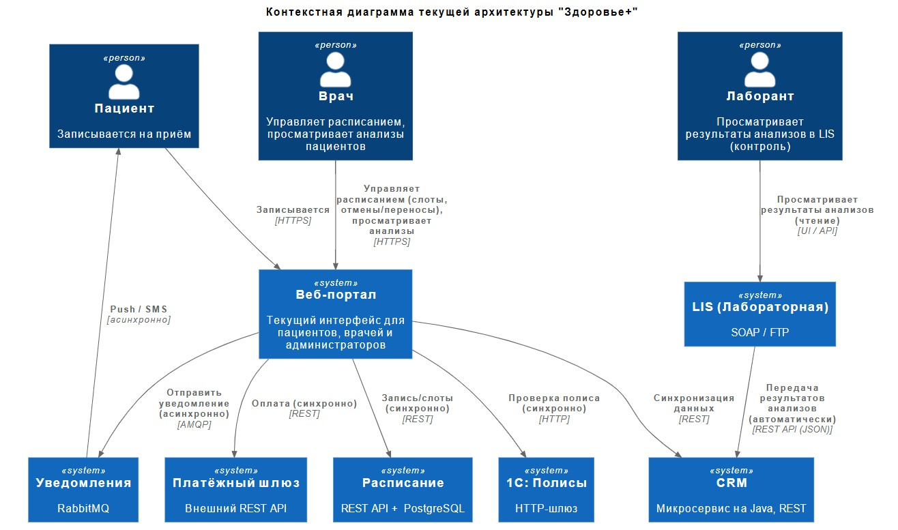

# Спринт 5. Интеграции как часть архитектуры решения

## О компании

Бизнес-модель «Здоровья+» сочетает платные услуги (консультации, диагностику и операции) и услуги по ДМС. Ключевые бизнес-процессы: запись пациентов, лабораторная диагностика, выписка рецептов, оплата, коммуникация (уведомления, результаты исследований и т. д.).
Последний год компания активно растёт. У неё открылись пять новых центров, а количество уникальных пациентов увеличилось на 40%. Это вызвало резкий рост нагрузки на ИТ-системы, которые исторически развивались фрагментарно. Часть систем (расписание и CRM) уже перешла на микросервисы, но остальная архитектура (лабораторная система и учёт полисов на 1С) осталась legacy.

## Цели бизнеса

Руководство «Здоровья+» решило запустить мобильное приложение для пациентов, которое должно поддержать сценарии:

- Запись к врачу онлайн.
- Получение результатов анализов без звонка в клинику.
- Оплата услуг.
- Управление полисами ДМС.
- Пуш-уведомления о статусе записи, готовности анализов и акциях.

**Через три месяца промежуточное решение (MVP)** должно запустить приложение с базовыми функциями (запись, оплата, уведомления), на 30% снизить нагрузку на кол-центр за счёт самозаписи и обеспечить стабильную работу при пиковой нагрузке в 500 одновременных пользователей вечерами и в выходные.
**Финальное решение (через год)** подразумевает, что доля онлайн-записи достигнет 70% от общего числа визитов, средний чек вырастет благодаря дополнительным услугам, предлагаемым в приложении, в часы пик оно будет способно выдерживать до 50 000 пользователей, а время отклика составит меньше одной секунды для 99% запросов, доступность 99.95%, а также обеспечивать горизонтальное масштабирование всех компонентов.

## Текущий ИТ-ландшафт

Существующие ИТ-системы и потоки данных представлены на диаграмме контекста С4 (Level 1):

## Технологический стек и функции систем

| ИТ-система | Функции | Технологии |
| -- | -- | -- |
| Расписание | Управление слотами врачей, запись пациентов, подтверждение и отмена записей | Java, REST, PostgreSQL |
| CRM | Ведение карточек пациентов, контактной информации, истории обращений. Содержит результаты анализов (из LIS) | Java, REST, PostgreSQL |
| LIS (лабораторная) | Хранение результатов анализов, автоматический приём данных с оборудования, передача результатов в CRM через REST API. Доступна лаборантам только для просмотра | SOAP, FTP для загрузки данных с оборудования, REST API для интеграции и передачи данных |
| Полисы | Проверка валидности полиса ДМС, прикрепление полиса к пациенту | 1С:Предприятие, HTTP-шлюз |
| Платёжный шлюз | Проведение онлайн-платежей (внешний поставщик) | REST API (синхронный) |
| Уведомления | Отправка электронных писем, СМС и пушей | RabbitMQ и внешние провайдеры электронной почты, СМС и пушей |

Для понимания текущего состояния системы из различных источников собрали информацию.

## Отзывы сотрудников

### Анна — Product Owner

«Мы уже третий месяц пытаемся запустить хотя бы MVP мобильного приложения, но дальше тестовых стендов дело не доходит. Сейчас главная боль — пациенты не видят анализы онлайн. Результаты доступны сотрудникам клиники в CRM, но это не помогает пациенту. Человеку приходится звонить, и мы отправляем результат на электронную почту, если он дозвонится.

При этом лаборатория может задерживать передачу данных в CRM на несколько часов. Автоматическая загрузка с оборудования иногда сбоит, тогда врач не видит анализы. Всё непредсказуемо.

Отдельная история с полисами. Часто онлайн‑проверка не находит полис, хотя через пять минут всё работает нормально. Техподдержка утверждает, что это лагает 1С, а бизнес теряет клиентов».

### Олег — Руководитель контакт‑центра

«Нам обещали, что с приложением звонков станет меньше. Однако его никак не запустят, а веб‑портал не справляется.

Пока каждый второй звонок: "Я записался онлайн, а меня не приняли". Причина — двойные записи или потери подтверждения. Люди платят, а слота нет. При этом деньги возвращаются неделями. У нас растёт число эскалаций.

Ещё пациенты спрашивают про результаты анализов. Мы не можем дать доступ к CRM, поэтому приходится пересылать скриншоты, что очень неэффективно.

Врачи тоже недовольны, что им неудобно управлять расписанием через веб‑портал: медленно и иногда не сохраняются изменения».

### Марина — Менеджер по развитию

«После запуска акции "Скидка 10 % на анализы при онлайн‑оплате" начался настоящий кошмар. Платежи падали, деньги списывались по два раза, люди злились. Так что акцию пришлось свернуть.

Сейчас мы боимся запускать любые предложения, связанные с оплатой, потому что это прямые убытки и репутационные потери. В итоге потенциальные пациенты уходят к конкурентам, у кого уже есть удобные мобильные приложения».

### Дмитрий — Техлид команды расписания

«Наша система расписания современная, микросервисная, но, когда к нам обращается веб‑портал, мы не умеем различать повторные запросы. Пациент дважды нажал "Записаться" — у нас две записи. Идемпотентности нет.

С базой данных тоже беда. В часы пик возникают блокировки на таблице слотов. Масштабирование чтения мы не сделали, потому что не было задачи, а теперь страдаем.

Кстати, врачи через портал правят расписание, но из‑за этих блокировок изменения вносятся с задержкой или не фиксируются вовсе».

### Елена — DevOps‑инженер

«Наш RabbitMQ держится буквально на честном слове. Пиковые нагрузки (вечером в понедельник) создают огромные очереди. Однажды мы превысили лимит, очередь упала с ошибкой 404 и пользователи не получили уведомления о записях. А сервис уведомлений висит на этом же RabbitMQ.

Плюс автоматическая загрузка результатов из лаборатории через FTP — отдельная песня. Потеря соединения, тайм‑ауты, никаких автоматических повторов. Если скрипт упал ночью, утром пациенты без анализов. Да, передача в CRM автоматическая, но она ненадёжна: иногда данные приходят с задержкой до двух часов. Мы не можем гарантировать своевременность».

### Алексей — Разработчик интеграций

«С 1С работать невозможно. Контракт меняется без уведомлений. В прошлом месяце вместо JSON стали возвращать XML и всё сломалось. Rate limiting нет, так что при небольшом всплеске запросов 1С просто перестаёт отвечать. Мы сделали временное решение: если ответа нет пять секунд, полис считаем временно валидным. Однако бизнес на это пока не подписывается.

Интеграция LIS с CRM работает через REST API. Коннектор написан на старом Perl, никто его не сопровождает — при сбоях перезапускаем вручную. Документации нет. Лаборанты заходят в LIS, только чтобы посмотреть, загрузились ли данные, но менять ничего не могут. Загрузка полностью автоматическая с анализаторов».

## Новости о компании

### «Онлайн‑запись в "Здоровье+" даёт сбой четвёртый раз за месяц»

Новосибирск, 15 марта

«Пациенты жалуются, что оплаченные записи теряются, а деньги не возвращаются. Клиника объясняет это техническими работами. Однако количество жалоб в соцсетях растёт. Пользователи советуют записываться по телефону, потому что так надёжнее».

### «Врачи "Здоровье+" перегружены, а система расписания не справляется»

Екатеринбург, 1 апреля

«В интервью главврач филиала рассказал, что из‑за затруднений электронного расписания врачам приходится вести запись в Excel, а потом вносить информацию вручную. Это занимает до двух часов в день».

### «Новая акция "Здоровье+". Здоровье без очередей?»

Москва, 20 апреля

«"Здоровье+" планирует запустить мобильное приложение, которое должно упростить запись и оплату. Однако эксперты сомневаются: компания известна проблемами с интеграцией легаси‑систем. Тем не менее рекламный бюджет уже заложен».

## Выгрузка из bug-трекинга (Jira)

| Jira ID | Тип | Приоритет | Компонент | Краткое описание |
| -- | -- | -- | -- | -- |
| INT-001 | Bug | Blocker | Платёжный шлюз | При тайм-ауте деньги списываются, статус платежа не фиксируется |
| INT-002 | Bug | Major | LIS | Автоматическая загрузка через FTP падает с ошибкой 425, требуется ручное восстановление. Задержка передачи в CRM до двух часов. |
| INT-003 | Bug | Critical | 1С | Проверка полиса падает с ошибкой 503 на пиках ( >50 rps). |
| INT-004 | Task | Minor | Уведомления | Документировать лимиты RabbitMQ. |
| INT-005 | Bug | Blocker | Расписание | Отсутствие идемпотентности — дубли записей при повторных POST. |
| INT-006 | Bug | Major | Веб-портал | SQL-инъекция в поле поиска пациента. |
| INT-007 | Bug | Critical | Интеграция (общее) | Отсутствие distributed tracing — сложно найти корень сбоя. |
| INT-008 | Bug | Major | LIS | Дублирование XML-файлов (сбой при передаче). В CRM попадают дубли анализов. |
| INT-009 | Task | Major | Расписание | Репликация базы данных для чтения (блокировки). |
| INT-010 | Epic | Critical | Мобильное приложение | Разработать API Gateway с rate limiting и идемпотентностью при внедрении. |
| INT-011 | Bug | Major | CRM | Неактуальные анализы (LIS передал, а CRM не обновила — застряло в очереди). |

## Тикеты в службе поддержки (Service Desk)

| ID | Дата | Тема | Описание | Статус |
| -- | -- | -- | -- | -- |
| SD-001 | 10.02 | Зависает проверка полиса | Администраторы жалуются, что 1С иногда отвечает дольше 30 секунд, а помогает только перезагрузка службы. | Resolved |
| SD-002 | 15.02 | Не приходит подтверждение записи | Пациент оплатил, подтверждение не пришло. В логах ошибка Booking not found для paymentID. | Open |
| SD-003 | 20.02 | Дубль записи на один слот | Пациент дважды нажал «Записаться», и образовалось две записи. | Closed |
| SD-004 | 25.02 | Зависание при оплате | При оплате мобильное приложение (тестовая версия) виснет на десять секунд, после чего выдаёт ошибку. | Resolved |
| SD-005 | 01.03 | Утром не видны анализы в CRM, загруженные ночью | Оказалось, что FTP-скрипт падал из-за тайм-аута, REST-коннектор не переотправил — пришлось запускать вручную. | Closed |
| SD-006 | 10.03 | Не приходит пуш-уведомление на Android | Очередь RabbitMQ была переполнена из-за пиковой нагрузки. | Resolved |
| SD-007 | 20.03 | Врач видит чужого пациента | Возможно, подмена сессии (security issue). | In Progress |
| SD-008 | 30.03 | При попытке записи появляется «Полис недействителен» | 1С вернул null, через пять минут повтор — успех. | Closed |
| SD-009 | 05.04 | Двойное списание денег | Дважды списали деньги при оплате. | In Progress |

## Что нужно сделать

Проектная работа состоит из четырёх заданий. Вам предстоит спроектировать целевую интеграционную архитектуру для внедрения мобильного приложения для «Здоровье+». Архитектура должна учитывать разнородность ИТ-систем, обеспечивать отказоустойчивость, масштабируемость и безопасность.
В результате должен получиться пакет документов по каждому из заданий, который поможет достичь целевого состояния мобильного приложения «Здоровья+».
