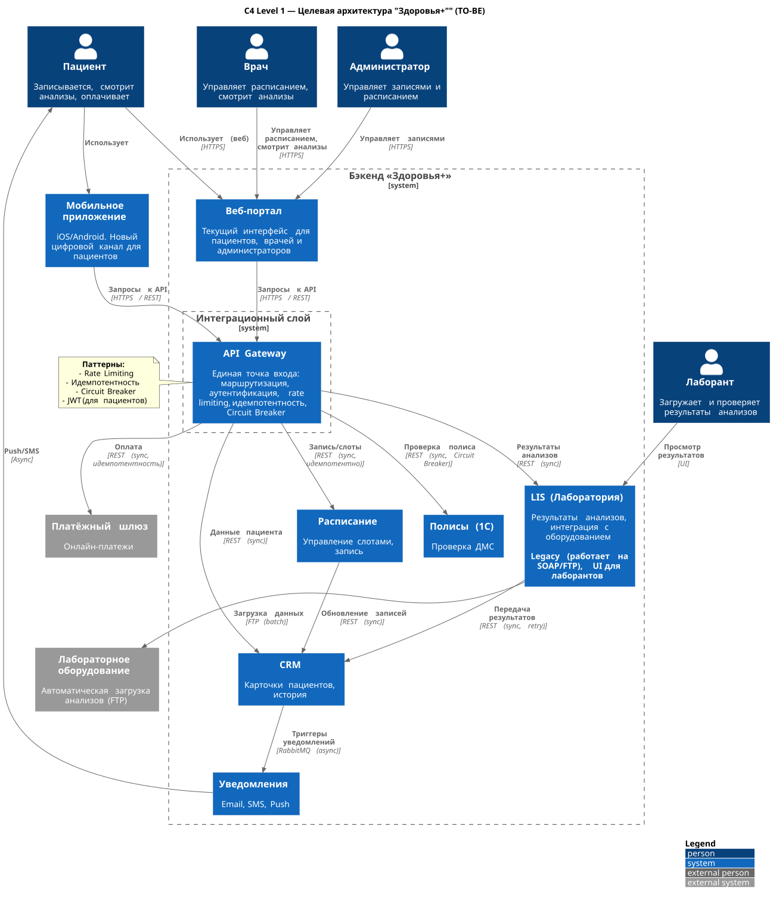

# Целевая интеграционная архитектура

Спроектирована целевая интеграционная архитектура ИТ-ландшафта "Здоровья+" для успешного внедрения мобильного приложения в виде C4 Level 1 диаграммы

Обоснование для интеграций:

| Интеграция | Стиль | Обоснование | Паттерны |
| -- | -- | -- | -- |
| Мобильное приложение — API Gateway | Синхронный (REST) | Пользователь ждет ответа (запись, оплата). Нужен немедленный отклик. Нужен Rate Limiting и Auth. | API Gateway, Rate Limiting, Auth (JWT) |
| Веб-портал — API Gateway | Синхронный (REST) | Веб-портал это внутренняя система, которая теперь ходит через единую точку входа. API Gateway позволяет централизовать безопасность, сделать единый мониторинг, позволит менять внутренние системы не трогая веб-портал | API Gateway, Rate Limiting, Auth (JWT/Session) |
| API Gateway — 1С (Полисы) | Синхронный + асинхронный fallback | 1С нестабильна (падает при >50 rps, меняет контракты). Синхронный вызов нужен для проверки, но с защитой | Circuit Breaker, Timeout (5 сек), Fallback (пометить полис "временно валидным" или отправить на ручную проверку) |
| API Gateway — Платёжный шлюз | Синхронный | Финансовая операция требует немедленного подтверждения. Подождать нельзя, но можно осторожно попробовать повторить попытку при неудаче, для этого нужна идемпотентность операции | Идемпотентность (Idempotency-Key), Retry (осторожно) |
| API Gateway — LIS | Синхронный (запрос) + переход на Асинхронный | Результаты анализов могут быть готовы позже. Если сразу данных нет. Можно добавить асинхронное уведомление через Push **ВАЖНО**: LIS это legacy (SOAP/FTP). Прямая доработка нецелесообразна. надо использовать Anti-Corruption Layer (адаптер) для трансформации REST-SOAP | Event Notification (запрос статуса), Polling, Anti-Corruption Layer |
| LIS — CRM | Асинхронный (событие) | Сейчас это синхронный REST, который падает. Нужно перейти на события (Kafka/RabbitMQ) с гарантией at-least-once | Event-Driven, Retry, DLQ |
| CRM — Уведомления | Асинхронный (RabbitMQ) | Уведомления не должны блокировать основной процесс. Очередь уже есть, но нужно настроить лимиты и DLQ. Один получатель, поэтому очередь ложится хорошо | Point-to-Point, DLQ |
| LIS — Оборудование | Пакетный (FTP) | Оборудование отдает файлы. Делает оно это с задержкой, подождать можно. Главное это добавить автоматический Retry и мониторинг. Нужно научиться автоматически восстанавливаться при сбое | Batch, Watchdog (мониторинг папки) |

## Пояснения по границам систем

- **Веб-портал** — внутренняя система "Здоровья+". В целевой архитектуре он ходит через API Gateway, чтобы централизовать безопасность и мониторинг.
- **LIS** — внутренняя legacy-система. Мы не переписываем её (судя по контексту это нецелесообразно делать), а оборачиваем адаптером (Anti-Corruption Layer).
- **Платёжный шлюз** и **лабораторное оборудование** — внешние системы. Для них используются Circuit Breaker, Retry и Fallback.
- **WAF** (ModSecurity на L7 LB) обеспечивает защиту от OWASP Top 10. Сейчас на схеме C4 Level 1 он не показан, т.к. это скорее часть внутренней инфраструктуры, как и RabbitMQ, и Kafka, и PostgreSQL в качестве БД внутренних сервисов. Но он будет иметь важное значение, детали будут в Task 4.3.
