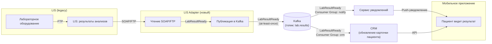

# Надёжная поставка результатов анализов в мобильное приложение

## 1. Описание решения

### Проблема

Сейчас LIS передаёт результаты анализов в CRM синхронным REST-вызовом. Этот процесс ненадёжен:

- при сбое LIS или CRM данные теряются.
- задержка может достигать 2 часов
- дубли записей (INT-008)
- нет гарантий доставки (INT-011)
- пациенты не видят результаты в приложении и звонят в кол-центр.

### Решение

Предлагается гибридная архитектура с использованием **адаптера (Anti-Corruption Layer)** и **асинхронной очереди Kafka**:

1. **LIS** (legacy) продолжает работать как есть (SOAP/FTP), т.е. модифицирование такой системы нецелесообразно делать
2. **Адаптер LIS** (новый сервис) читает данные из LIS (через SOAP или FTP) и публикует событие `LabResultReady` в Kafka
3. **CRM** читает событие из Kafka (с гарантией at-least-once), обновляет карточку пациента
4. **Сервис уведомлений** читает событие из Kafka и отправляет Push-уведомление пациенту через мобильное приложение
5. **Мобильное приложение** запрашивает результат из CRM через API Gateway.

Такой гибридный вариант позволяет получить:

- **Гарантия доставки.**  
  Kafka с at-least-once (`acks=all, retry`) гарантирует, что событие не потеряется
- **Минимальная задержка.**  
  Адаптер публикует событие сразу после готовности результата (не раз в час, как FTP)
- **Развязка.**  
  LIS не зависит от CRM. Если CRM упала, событие ждёт в Kafka, а не теряется
- **Идемпотентность.**  
  CRM проверяет `event_id` перед обновлением, чтобы избежать дублей
- **DLQ.**  
  Если CRM не может обработать событие, оно уходит в Dead Letter Queue для ручного разбора
- **Изоляция legacy**  
  LIS это legacy (SOAP/FTP), мы не можем её переписать, но можно обернуть адаптером (Anti-Corruption Layer), который читает FTP/SOAP и публикует событие в Kafka

Для решения применяется именно новый стек Kafka, а не имеющийся уже RabbitMQ:

1. Результаты анализов это критичные данные, их потеря недопустима. Kafka позволит получить проще at-least-once с retention (например, 7 дней).
2. Имеется несколько получателей (CRM, Notify, возможно в будущем Analytics), что решается разными consumer groups, каждая читает в своем темпе.
3. Retention и Replay дают защиту от сбоев (в RabbitMQ с этим сложнее).
4. Изоляция от RabbitMQ, как мы знаем из контекста задачи — он уже нестабилен.

## 2. Таблица сравнения альтернатив

Видится несколько вариантов, как можно реализовать:

1. Синхронный REST (LIS — CRM) как сейчас
2. Асинхронная очередь (LIS — Kafka — CRM)
3. Пакетная выгрузка через S3 (LIS — S3 — CRM)
4. Гибрид: LIS — адаптер — Kafka — CRM

| Критерий | Синхронный REST (AS-IS) | Асинхронная очередь (Kafka) | Пакетная выгрузка (S3) | Гибрид: адаптер + Kafka (выбрано) |
| -- | -- | -- | -- | -- |
| **Гарантия доставки** | Нет (at-most-once) | At-least-once | At-least-once (с retry) | At-least-once |
| **Задержка** | Секунды (если работает) | Секунды | Часы | Секунды |
| **Устойчивость к сбоям** | Низкая (падает) | Высокая (буферизация) | Средняя (зависит от расписания) | Высокая |
| **Сложность** | Низкая | Средняя | Низкая | Средняя |
| **Поддержка legacy (LIS)** | Да (ненадёжно) | Нет (LIS не умеет Kafka) | Да (FTP) | Да (адаптер) |
| **Дубли** | Да (INT-008) | Нет (идемпотентность) | Нет (идемпотентность) | Нет (идемпотентность) |
| **Масштабируемость** | Низкая | Высокая | Средняя | Высокая |
| **Эксплуатация** | Простая | Средняя (нужна Kafka) | Простая | Средняя/Высокая (нужна Kafka + адаптер) |

Гибридный вариант (адаптер + Kafka) — оптимальный выбор. Он сочетает поддержку legacy (LIS) с гарантией доставки и минимальной задержкой. Однако потребует новый стек Kafka и написания адаптера (Anti-Corruption Layer).

## 3. Блок-схема потока данных

## 4. Детали реализации

### 4.1. Адаптер LIS (Anti-Corruption Layer)

- **Задача**: читает данные из LIS и публикует событие в Kafka. LIS это legacy, и разные типы данных могут передаваться по разным каналам. Адаптер поддерживает оба, чтобы не зависеть от одного хрупкого канала:
  - **SOAP**: если LIS поддерживает передачу результатов по SOAP, то адаптер вызывает SOAP-метод
  - **FTP**: если LIS выгружает файлы на FTP, то адаптер мониторит папку (Watchdog) и читает новые файлы
- **Как публикует**: в топик `lab.results` с ключом `patient_id` (для порядка следования) и `event_id`
- **Гарантия**: at-least-once (`acks=all, retry`)

### 4.2. Kafka

- **Топик**: `lab.results`
- **Партиционирование**: по `patient_id` (чтобы события одного пациента обрабатывались по порядку)
- **Гарантия**: at-least-once (`acks=all, min.insync.replicas=2`)
- **Retention**: 7 дней (для replay при сбоях)
- **DLQ**: `lab.results.dlq` для событий, которые не удалось обработать

### 4.3. CRM

- **Consumer Group**: `crm-lab-results`
- **Идемпотентность**: проверяет `event_id` перед обновлением карточки
- **Retry**: 3 попытки с экспоненциальной задержкой
- **DLQ**: если не удалось обработать, событие уходит в `lab.results.dlq` для последующего ручного разбора

### 4.4. Сервис уведомлений

- **Consumer Group**: `notify-lab-results`
- **Идемпотентность**: проверяет `event_id` перед отправкой
- **Что делает**: отправляет Push-уведомление пациенту о том, что готовы результаты

### 4.5. Мобильное приложение

- **Как получает результат**: приходит Push-уведомление, пациент открывает приложение, приложение запрашивает результат через API Gateway у CRM
- **Кэширование**: результат кэшируется на 5 минут (чтобы не дёргать CRM)

### 5. Метрики и мониторинг

1. Latency. Время от готовности результата в LIS до появления в приложении
2. Success rate. Процент успешно доставленных событий
3. DLQ size. Количество событий в DLQ (должно быть 0)
4. Consumer lag. Отставание CRM и Notify от Kafka.

### 6. Риски и их смягчения

| Риск | Вариант смягчения |
| -- | -- |
| LIS не поддерживает SOAP | Используем FTP + Watchdog на файлы |
| Kafka недоступна | Адаптер буферизует события локально (outbox-table) |
| CRM не может обработать событие | DLQ + алерт |
| Дубли событий | Идемпотентность по `event_id` |
