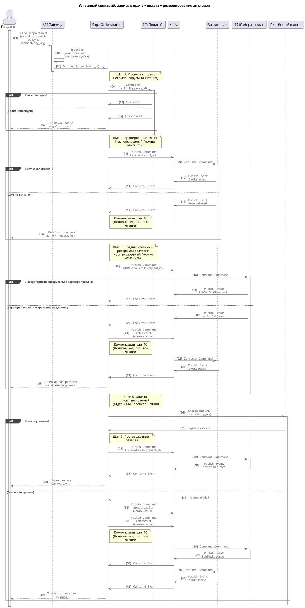

# Автоматизация бизнес-операции «Запись к врачу с оплатой и резервированием сдачи анализов»

Рассматриваемый сценарий: пациент записывается к врачу, оплачивает, и после оплаты резервируется время для сдачи анализов (LIS).

Шаги:

1. Бронирование слота записи (Расписание)
2. Проверка полиса (1С)
3. Оплата (Платёжный шлюз)
4. Резервирование слота лабораторного исследования (LIS)

Судя из контекста задания, сейчас есть ряд проблем,которые надо решить:

- синхронная цепочка без таймаутов
- нет компенсаций
- дубли записей
- двойные списания

## 1. Диаграмма последовательности (успешный сценарий)

Оплата — это почти необратимая транзакция (Refund — сложный внешний бизнес-процесс, который занимает дни). Поэтому её нужно ставить как можно позже, чтобы минимизировать дорогие компенсации.

Однако бизнес-логика требует, чтобы лаборатория резервировалась "после оплаты". Чтобы совместить это, будем использовать предварительный резерв лаборатории перед оплатой и подтверждение резерва после оплаты:

1. Проверка полиса (чтение).
2. Бронирование слота (компенсируемо).
3. **Предварительный резерв** лаборатории (компенсируемо).
4. Оплата (необратимо).
5. **Подтверждение резерва** лаборатории — после оплаты.

Если оплата не прошла — отменяем предварительный резерв (это сделать дёшево).  
Если лаборатория занята на шаге 3 — отменяем слот (это сделать дёшево).  
Если лаборатория занята на шаге 5 (после оплаты) — это очень редкий случай, ведь предварительные проверки резерва уже прошли успешно, время выделено. В таком случае уже можно запускать процесс Refund.

Итого, шаг оплаты — для нас это точка невозврата — сдвигается на самый конец, когда все проверки уже прошли. При этом отмена предварительного резерва лаборатории и слота к врачу — быстрые внутренние операции, их проще выполнить.

Такой процесс всё ещё соответствует бизнес-логике, потому что подтверждается лаборатория уже после оплаты, как и было в исходном бизнес-процессе.

Кроме того, на первый шаг переносим проверку полиса. Это операция чтения, её компенсировать не надо, но от результата будет зависеть — имеет ли смысл выполнять следующие шаги. Если окажется, что полис недействительный, то бизхнес-процесс должен прерваться.

## 2. Обоснование выбора типа SAGA

Выбрана асинхронная оркестрация (**Parallel Saga**). Особенность этого варианта — сбалансированное решение, обеспечивающее управляемость, масштабируемость и отказоустойчивость.

Процесс включает пять шагов с ветвлениями (проверка полиса может не пройти, оплата может не пройти, резерв лаборатории может не пройти, временной слот у врача может быть занят), поэтому нужен центральный оркестратор, который управляет последовательностью и компенсациями. Асинхронность через брокер (Kafka) позволяет не блокировать потоки и пережить сбои отдельных сервисов. Оркестратор хранит состояние (Saga log) в БД, что позволяет восстановить процесс после сбоя.

Хореография здесь не подходит: процесс сложный, и логика "размажется" по сервисам, что усложнит отладку, аудит и компенсации.

### Saga log и appointment_id

Saga log — это журнал состояния Saga, который хранится в БД оркестратора. Для каждого экземпляра Saga (для каждой записи) хранится:

- текущий шаг (на каком этапе процесс).
- статус каждого шага (`NOT_STARTED`, `IN_PROGRESS`, `COMPLETED`, `FAILED`, `COMPENSATED`).
- статус компенсаций (запущены ли, завершены ли).
- контекст (`payment_id`, `slot_id`, `refund_id`).

Если оркестратор упадёт, он восстанавливает процесс с последнего сохранённого шага. Также Saga log (как и сама Saga через оркестратор) закрывает вопросы более прозрачного аудита и отладки.

`appointment_id` — уникальный ID записи к врачу. Он используется для:

- идемпотентности: повторный запрос с тем же `appointment_id` не создаёт новую запись
- для связи Saga log с бизнес-сущностью (записью).

## 3. Таблица компенсирующих транзакций

| ## | Шаг сценария | Компенсирующее действие | Риск, который устраняется |
| -- | -- | -- | -- |
| 1 | Проверка полиса | Нет компенсации (только чтение) При недоступности 1С — fallback: запись с флагом `pending` на подтверждение администратору | Пациент не может записаться, звонит в кол-центр |
| 2 | Бронирование слота записи | Отмена бронирования (ReleaseSlot) | Слот остаётся занятым, хотя запись не состоялась |
| 3 | Предварительное резервирование лаборатори | Отмена резервирования (ReleaseLabSlot) | Время в лаборатории зарезервировано, другой пациент не может записаться на слот |
| 4 | Оплата | Возврат средств (Refund) с идемпотентностью по `refund_id` | Деньги списаны, но запись не создана |
| 5 | Подтверждение резервирования лабораторного исследования | Отмена резервирования (HardReleaseLabSlot) | Время в лаборатории зарезервировано, другой пациент не может записаться на слот |

### Fallback для проверки полиса

Проверка полиса это операция чтения, ей компенсирующая транзакция не нужна.

Однако, если 1С недоступна (таймаут 5 секунд или ошибка 5xx):

- запись создаётся с флагом `policy_status = 'pending'`
- пациент получает подтверждение записи
- администратору должно отправляться уведомление: "Проверить полис для записи #42"
- если полис окажется недействительным — администратор отменяет запись и связывается с пациентом.

Да, это добавляет ручную операцию проверки, но это компромисс.

Из информации от Алексея (разработчика): если ответа от 1C по полисам нет в течении 5 секунд, полис считается валидным и бизнес на это не хочет подписываться.

Одна из бизнес-целей — снизить нагрузку на кол-центр. Полный отказ при недоступности 1С заставит пациента звонить. Но полное разрешение — вызывает риски (например мошенничество с полисами), что бизнесу не нравится. Поэтому Флаг "pending" даёт баланс: риск под контролем, пациент записан, в кол-центр не звонят.

### Компенсация для оплаты (Refund)

Возврат средств — это отдельный бизнес-процесс, отдельная операция, которая должна быть идемпотентной, и кроме того, процесс возврата средств может занимать дни.

Шаги:

1. Оркестратор вызывает `Refund(payment_id, refund_id)`
2. Платёжный шлюз принимает запрос и возвращает `refund_status = 'pending'`
3. Оркестратор сохраняет статус в Saga log и продолжает компенсацию (не блокируется)
4. Платёжный шлюз асинхронно обрабатывает возврат (1-3 дня)
5. Если возврат успешен, обновляется статус операции на `refund_status = 'completed'`
6. Если возврат не удался, обновляется статус операции на `refund_status = 'failed'`, генерируется алерт, инициируется ручной разбор ситуации.

**Идемпотентность:** `refund_id` — уникальный UUID, который генерируется при первом вызове Refund. При повторном вызове с тем же `refund_id` платёжный шлюз возвращает сохранённый результат.

Без идемпотентности повторный Refund (или наш осторожный retry, при сбое сети) вернёт деньги дважды. Это прямые финансовые потери, которые следует избегать.

## 4. Механизм обеспечения идемпотентности на входе

На входе (API Gateway) используется **Idempotency-Key** — уникальный UUID, который клиент генерирует для каждой операции и передаёт в заголовке `Idempotency-Key`.

Шаги применения:

1. Клиент (мобильное приложение) генерирует UUID при первом нажатии кнопки "Записаться" и до получения ответа от системы.
2. Передаёт его в заголовке `Idempotency-Key: <uuid>`.
3. API Gateway проверяет ключ в Redis:
   - Если ключ уже есть — возвращает сохранённый результат (не создаёт новую запись)
   - Если ключа нет — сохраняет ключ в Redis с TTL 24 часа, пропускает запрос дальше, а после получения результата его также сохраняет в Redis с тем же ключом
4. При повторном запросе с тем же ключом — возвращается тот же результат (сохраненный в Redis).

Таким образом, если пациент дважды нажал кнопку, может быть сгенерировано два запроса, но с одинаковым Idempotency-Key. Второй запрос на возвращает результат первого. В дополнение, для исключения ситуации с двойным нажатием кнопки, в Мобильном приложении необходимо блокировать кнопку после первого нажатия.

Если повторная отправка того же сообщения произошла не по причине повторного нажатия кнопки, а из-за Retry при сбое сети, Idempotency-Key остается тем же, результат тот же.

Заданный TTL на 24 часа позволит не накапливать ключи в кеше. Пороговое значение в 1 сутки выглядит адекватным.

В дополнение, на уровне Saga Orchestrator также должен проверяться и `appointment_id` (уникальный ID записи), чтобы избежать дублей на уровне бизнес-логики.
