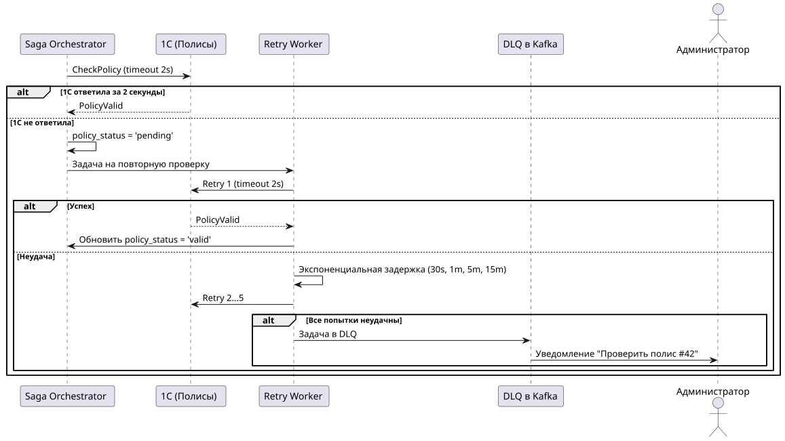
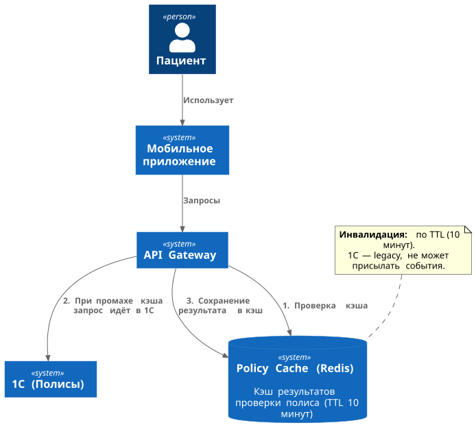

# Реализация отказоустойчивости интеграции между ИТ-системами

Критически важные для бизнеса система 1С ("Полисы") и внешний платёжный шлюз — постоянные источники сбоев. 1С периодически не выдерживает нагрузку больше 50 RPS и может зависать более чем на 30 секунд. Платёжный шлюз при тайм-аутах приводит к списанию денег без фиксации статуса.

## 1.1. Таблица с обоснованием параметров для платёжного шлюза

| Параметр | Значение | Обоснование |
| -- | -- | -- |
| **Таймаут** | 10 секунд | Платёжный шлюз внешняя система. 10 секунд — достаточно, чтобы шлюз ответил. Если дольше, то что-то идет не так |
| **Retry** | 1 попытка (только с Idempotency-Key) | Если таймаут — деньги могли списаться, но мы об этом не узнаем. Но простой повтор без идемпотентности приводит к двойному списанию. С Idempotency-Key можно будет повторить |
| **Интервал retry** | 2 секунды (фиксированный) | Даём шлюзу время отпустить транзакцию.|
| **Circuit Breaker** | Да | Платёжный шлюз внешняя система. CB защищает нас от зависания шлюза, но не спасает шлюз |
| **Порог Circuit Breaker** | 50% ошибок за 20 запросов | |
| **Время в Open** | 60 секунд | |
| **Fallback** | "Платёж в обработке" (`PENDING`) | Если шлюз недоступен, нужно сохранить заказ в статусе `PENDING` и уведомить пациента |

## 1.2. Таблица с обоснованием параметров для 1С

| Параметр | Значение | Обоснование |
| -- | -- | -- |
| **Таймаут** | 2 секунды | 1С может зависать >30 секунд, но ждать 30 секунд пациент не станет. Если 1С не ответила за 2 секунды — переводим в `pending`. |
| **Retry** | 5 попыток (асинхронный Retry Worker) | 1С нестабильна, но retry должен быть осторожным, ведь если 1С зависла, повтор не поможет. Синхронное ожидание 5 попыток заблокировало бы пациента на 10+ секунд, что приведёт к звонкам в кол-центр. Нужен фоновый процесс Retry Worker, выполняющий повторные запросы асинхронно. |
| **Интервал retry** | Экспоненциальный | Задержки: 30 сек, 1 мин, 5 мин, 15 мин. |
| **DLQ** | После 5 попыток | Задача уходит в DLQ, администратор проверяет вручную. |
| **Circuit Breaker** | Да | 1С падает при >50 RPS. CB с Half-Open размыкает цепь при 50% ошибок за 10 запросов, чтобы не добивать 1С и не тратить ресурсы. CB на фоне проверяет 1С, прежде чем снова запустить на него запросы. |
| **Порог Circuit Breaker** | 50% ошибок за 10 запросов | |
| **Время в Open** | 30 секунд | |
| **Fallback** | Запись с флагом статуса `pending` | Пациент записан, администратор проверит позже. |

### Детали решения с асинхронным retry с DLQ

1С может зависать >30 секунд. Синхронное ожидание блокирует пациента. Полностью асинхронная проверка без контроля приводит к тому, что администратору падают все записи подряд.

В качестве решения: асинхронный retry с экспоненциальной задержкой и DLQ.

Асинхронный retry — не блокирует пациента (дальнейшие шаги по записи пациента к врачу и т.д. будут проходить, только в статусе полиса будет `pending`), но и не оставляет задачу без контроля. Этой задачей может заниматься отдельный фоновый поток внутри оркестратора, однако лучше реализовать отдельный сервис (Retry Worker), который будет взаимодействовать с Kafka.

Экспоненциальная задержка — не перегружает 1С. Если спустя некоторое количество попыток получить ответ от 1С так и не удалось, эта задача переводится в DLQ для ручного разбора администратором.

Шаги:

1. **Оркестратор отправляет запрос в 1С (HTTP/SOAP) с таймаутом 2 секунды**
   - если 1С ответила за 2 секунды — статус проверки полиса `'valid'` (или `'invalid'`)
   - если 1С не ответила за 2 секунды — запись создаётся с флагом `'pending'`, задача ставится в очередь на повторную проверку.

2. **Retry Worker (фоновый сервис) берёт задачу из очереди**
   - повторяет запрос в 1С с таймаутом 2 секунды
   - если успех — обновляет статус полиса
   - если неудача — ставит задачу обратно в очередь с экспоненциальной задержкой: 30 секунд, 1 минута, 5 минут, 15 минут.

3. **После 5 попыток задача уходит в DLQ**
   - администратор получает уведомление: "Проверить полис для записи #42"
   - администратор проверяет вручную и обновляет статус и при необходимости связывается в пациентом.

## 2. Обоснование приоритета Circuit Breaker

Circuit Breaker критичнее для 1С, чем для Платёжного шлюза. Однако для Платежного шлюза он тоже нужен, чтобы защитить нашу систему.

- 1С — система в нашем контуре. Мы можем дать ей время восстановиться. Circuit Breaker размыкает цепь и даёт 1С передышку.
- 1С падает при >50 RPS. Если мы продолжим слать запросы, мы будем ещё больше добивать 1С, которой и без того плохо. Circuit Breaker защищает 1С от перегрузки.
- Платёжный шлюз — внешняя система. Мы не можем его починить. Circuit Breaker защищает нас от зависания, но не влияет на сам шлюз. Однако нам тоже надо защититься от недоступности Платежного шлюза.

Механизм работы Circuit Breaker:

- **Closed:** запросы проходят. Если ошибок <50% — остаётся  в Closed.
- **Open:** если ошибок для 1С — больше 50% за 10 запросов, для платёжного шлюза — больше 50% за 20 запросов, то размыкается. Запросы не проходят через Circuit Breaker, сразу возвращается Fallback.
- **Half-Open:** через 30 секунд (время простоя в Open) — пропускает 3 пробных запроса. Если они успешны, то переходим в статус Closed. Если не успешны, то возвращается в Open.

## 3. Архитектурное решение для снижения нагрузки на 1С

**Решение:** кэширование результатов проверки полиса в Redis.

Шаги:

1. API Gateway проверяет полис через 1С.
2. Результат кэшируется в Redis на 10 минут (ключ: `policy:{policy_id}`).
3. Если полис запрашивается повторно в течение 10 минут, то ответ берётся из кэша, а 1С не дёргается.
4. Инвалидация — по TTL (10 минут).

Пациент может записываться несколько раз подряд к разным врачам, либо записаться, отменить запись, записаться повторно. Кэш снижает нагрузку на 1С. 10 минут — достаточный и разумный TTL. При пиковой нагрузке кэш снижает RPS на 1С в разы.

1С — внутренняя legacy-система. Мы не можем её модифицировать. Инвалидация по событию из 1С невозможна. Поэтому инвалидация остаётся по TTL. Однако, если критично, можно добавить в UI возможность принудительного сброса кеша администратором.

Кэш живет 10 минут. Если пациент обновил полис в 1С, кэш об этом не узнает. Но через 10 минут кэш протухнет, и следующий запрос пойдёт в 1С за свежими данными.

Есть риск, если пациент обновил полис, а через 2 минуты записывается — кэш может вернуть старые данные. Но это приемлемый риск, т.к. окно в 10 минут небольшое (можно подождать), обновление полиса это редкое событие.

### Паттерн кэширования

**Cache-Aside** (Lazy Loading):

1. API Gateway проверяет кэш (Redis).
2. Если данные есть (cache hit) — возвращает их.
3. Если данных нет (cache miss) — API Gateway идёт в 1С.
4. API Gateway сохраняет результат в Redis.
5. API Gateway возвращает результат.

### Фрагмент диаграммы C4 Level 1

