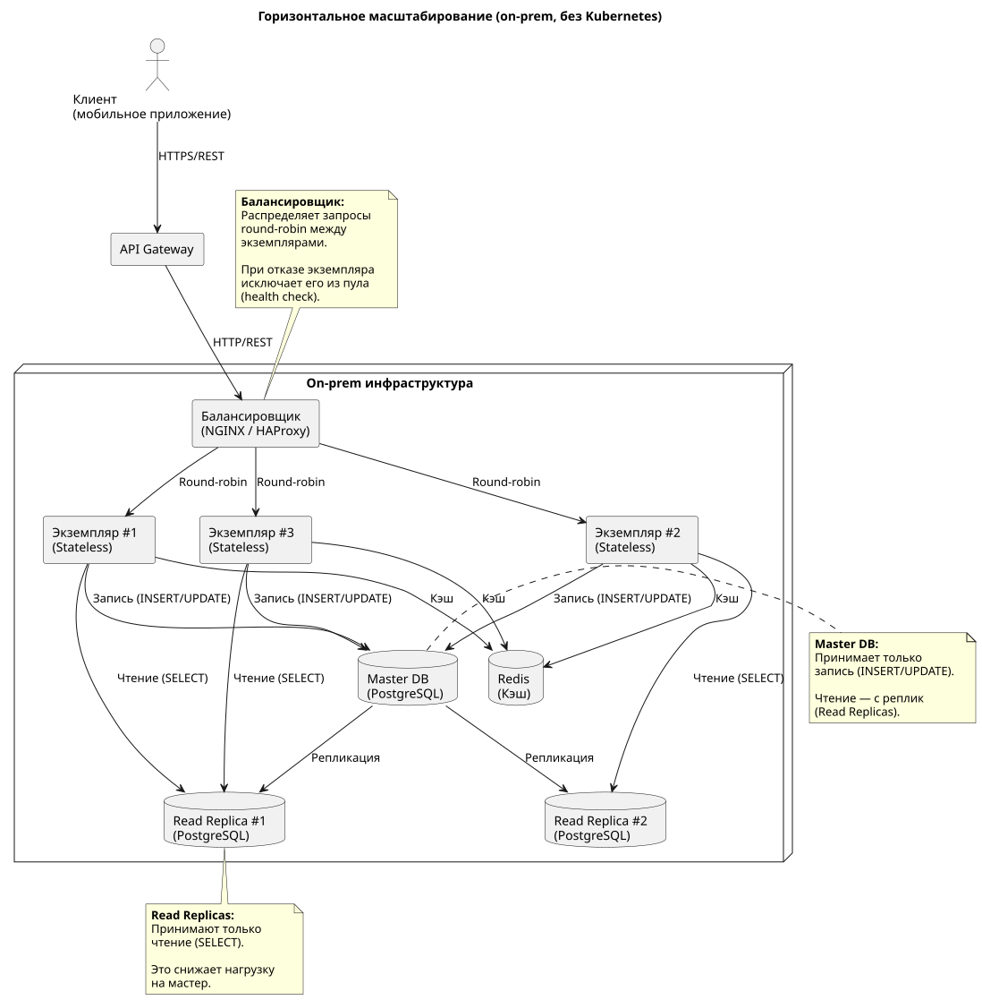

# Стратегия горизонтального масштабирования

Основная цель бизнеса: 50 000 пользователей в пике, отклик < 1 секунды. Требуется масштабирование системы.

## 1. Выбор критичных ИТ-систем

Для горизонтального масштабирования из контекста "Здоровья+" самые критичные для мобильного приложения:

1. **Расписание** — высоконагруженная система записи к врачу. Каждый пациент делает запись, поэтому нагрузка растёт линейно с числом пользователей.
2. **CRM** — система хранения карточек пациентов и результатов анализов. Через неё идёт чтение данных пациента, которое также растёт с числом пользователей.

Для задания не выбрали LIS (Лаборатория), потому что это legacy-система. Мы не масштабируем её горизонтально, а оборачиваем адаптером.

Для задания не выбрали 1С (Полисы), потому что это legacy-система. Мы не масштабируем её горизонтально, а кэшируем и защищаем Circuit Breaker.

## 2. Таблица стратегий масштабирования

| ИТ-система | Реализация горизонтального масштабирования | Ограничение | Решение |
| -- | -- | -- | -- |
| **Расписание** | 1. Переводим в stateless (состояние храним в PostgreSQL) 2. Запускаем несколько экземпляров за балансировщиком  3. Количество экземпляров регулируется автоматически (HPA в Kubernetes или аналог в другой платформе оркестрации) | Блокировки в PostgreSQL на таблице слотов | 1. Оптимистичные блокировки 2. Read Replicas 3. Партиционирование таблицы слотов по дате |
| **CRM** | 1. Переводим в stateless (состояние храним в PostgreSQL) 2. Запускаем несколько экземпляров за балансировщиком 3. Количество экземпляров регулируется автоматически | Тяжёлые SQL-запросы к production-БД | 1. Read Replicas 2. CQRS 3. Кэширование часто читаемых данных (карточки пациентов) в Redis |

**Примечание:** если платформа оркестрации, например Kubernetes, не внедрена, т.е. имеем on-prem без оркестратора, то можно использовать Docker Compose + NGINX/HAProxy. Однако это потребует ручного управления экземплярами (добавление/удаление контейнеров при росте/падении нагрузки).

## 3. Детали реализации

### 3.1. Расписание

**Причины ограничения**: при нескольких экземплярах возникает конкуренция за блокировки, одни и те же слоты пациенты могут одновременно пытаться занять. Это приведет к деградации производительности записи ко врачу.

**Решение**:

- **Stateless:** состояние (слоты, записи) хранится в PostgreSQL. Экземпляры Расписания не хранят ничего локально, поэтому можно будет запускать сколько угодно экземпляров.
- **Балансировка:** Kubernetes HPA или аналог в другой платформе оркестрации автоматически добавляет экземпляры при росте нагрузки (например, при >70% CPU). Балансировщик (NGINX/HAProxy) распределяет запросы round-robin.
- **Оптимистичные блокировки:** вместо пессимистичной блокировки `SELECT FOR UPDATE` (которая держит строку заблокированной до коммита) используем оптимистическую блокировку через поле `version` (или `revision`) в таблице в БД.
- **Read Replicas**: список доступных слотов читается с реплики (read-only). Бронирование производится на мастере. Это снижает нагрузку на мастер.
- **Партиционирование**: таблица `slots` партиционируется по дате (например, по месяцам). Это уменьшает размер индексов и ускоряет запросы.

### 3.2. CRM

**Причины ограничения**: при нескольких экземплярах возникает ситуация, что они одновременно делают тяжёлые запросы к одной БД. Возникает конкуренция за ресурсы, что приводит к деградации.

**Решение**:

- **Stateless**: состояние (карточки пациентов, история) хранится в PostgreSQL. Экземпляры CRM не хранят ничего локально.
- **Балансировка**: Kubernetes HPA или аналог в другой платформе оркестрации автоматически добавляет экземпляры при росте нагрузки (например, при >70% CPU). Балансировщик (NGINX/HAProxy) распределяет запросы round-robin.
- **Read Replicas**: чтение карточек пациентов и истории идёт на реплику. Запись (обновление карточки) направляется на мастер. Это снижает нагрузку на мастер и ускоряет чтение.
- **Кэширование**: часто читаемые данные (карточки пациентов, результаты анализов) кэшируются в Redis на 5 минут. Это снижает нагрузку на реплику.
- **CQRS**: разделение модели записи (мастер) и модели чтения (реплика). Если возникнут тяжёлые аналитические запросы (например, "сколько пациентов записалось за месяц") они будут исполняться на репликах, не блокируя мастер.

### 3.3. Схема горизонтального масштабирования (общая для Расписания и CRM)

На схеме показан общий паттерн для обеих систем:

- **Балансировщик** (NGINX/HAProxy) распределяет запросы round-robin.
- **Несколько экземпляров** сервиса (stateless) можно масштабировать горизонтально.
- **Master DB** принимает только запись.
- **Read Replicas** принимают только чтение (снижает нагрузку на мастер).
- **Redis** кэш для часто читаемых данных (например карточки пациентов).

Этот паттерн применим и к Расписанию (запись слотов на мастер, чтение слотов с реплик), и к CRM (запись карточек на мастер, чтение карточек и истории с реплик).

## 4. Итог

Обе системы переведены в stateless и готовы масштабироваться горизонтально.

Ключевые ограничения (блокировки в PostgreSQL для Расписания, тяжёлые SQL-запросы для CRM) решены через оптимистичные блокировки, Read Replicas, кэширование и CQRS. Это позволяет обслуживать 50 000 пользователей в пике с откликом < 1 секунды.
