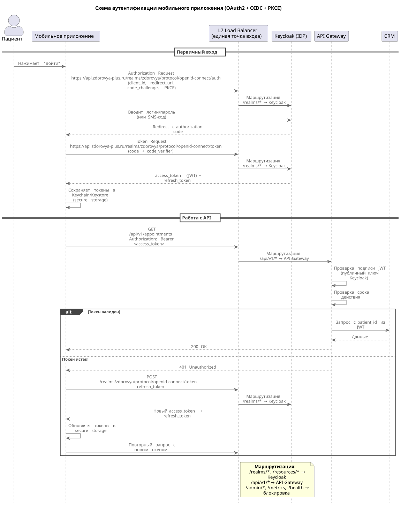

# Проектирование базовых мер безопасности

В ИТ-системах "Здоровья+" уже обнаружены проблемы безопасности. В частности, SQL-инъекция и возможная подмена сессии. Новое мобильное приложение, обрабатывающее персональные и медицинские данные, также станет привлекательной целью для атак, поэтому изначально в него нужно заложить основы безопасной интеграции.

## 1. Схема аутентификации пользователей мобильного приложения

### Протокол и способ передачи токена

OAuth2 — стандарт для авторизации. OIDC — надстройка для аутентификации. Поэтому в качестве протокола выберем этот способ.

Авторизация будет возвращать JWT токен. JWT содержит `patient_id`, роли, scope, срок действия. Токен передаётся в заголовке (не в URL), чтобы не логировался.

Keycloak — open-source IdP, поддерживает OIDC, JWT, RBAC, развёртывание on-prem. Выберем его, он будет развёрнут внутри системы.

**Протокол:** OAuth2 + OIDC (OpenID Connect) через Keycloak (IdP).

**Способ передачи токена:** JWT в заголовке `Authorization: Bearer <access_token>`.

### Алгоритм реализации

1. Пациент нажимает "Войти" в мобильном приложении.
2. Приложение открывает системный браузер и идёт на  
   `https://api.zdorovya-plus.ru/realms/zdorovya/protocol/openid-connect/auth`  
   с параметрами `client_id`, `redirect_uri`, `code_challenge` (PKCE).
3. L7 Load Balancer (Reverse Proxy) маршрутизирует запрос `/realms/*` в Keycloak.
4. Пациент вводит логин/пароль на странице Keycloak.
5. Keycloak перенаправляет обратно в приложение с одноразовым **authorization code**.
6. Приложение идёт на  
   `https://api.zdorovya-plus.ru/realms/zdorovya/protocol/openid-connect/token`  
   с `code` и `code_verifier` (PKCE), получает `access_token` (JWT) и `refresh_token`.
7. Приложение сохраняет токены в безопасном хранилище.
8. При каждом запросе к API приложение передаёт `access_token` в заголовке `Authorization: Bearer <token>`.
9. L7 Load Balancer (Reverse Proxy) маршрутизирует запрос `/api/v1/*` в API Gateway.
10. API Gateway проверяет подпись JWT (публичным ключом Keycloak) и срок действия.
11. Если токен валиден — пропускает запрос, передаёт `patient_id` в CRM.
12. Если токен истёк — возвращает приложению код `401 Unauthorized` b приложение использует `refresh_token` для получения нового `access_token` (шаги 6–7 повторяются).

### Сетевая архитектура

Keycloak и API Gateway находятся за единым L7 Load Balancer (NGINX/Envoy). Клиент обращается к одному домену: `api.zdorovya-plus.ru`.

**Правила маршрутизации на балансировщике:**

- `/realms/*`, `/resources/*` маршрутизируются в Keycloak (OIDC-поток)
- `/api/v1/*` маршрутизируются в API Gateway
- `/admin/*`, `/metrics`, `/health` должны быть заблокированы и не доступны из интернета.

Получается что Клиент (Мобильное приложение) знает только один домен и для авторизации и для работы с системой. При этом административная панель Keycloak и метрики не выставлены наружу, что снижает поверхность атаки. Кроме того, Keycloak и API Gateway находятся в приватной сети.

**CORS:**

Для мобильного приложения CORS не требуется. Но для для веб-портала в настройках клиента Keycloak указывается `Web Origins` с доменом портала (`https://portal.zdorovya-plus.ru`). CORS-заголовки возвращает сам Keycloak (не балансировщик), чтобы избежать конфликтов.

### Схема

## 2. Политика rate limiting

| Тип запроса | Лимит | Действие при превышении |
| -- | -- | -- |
| **Публичный "Поиск врачей"** | 50 запросов/мин на IP | 429 Too Many Requests + заголовок `Retry-After: 60` |
| **Авторизованный "Создание записи к врачу"** | 10 запросов/мин на пользователя (по `patient_id` из JWT) | 429 Too Many Requests + заголовок `Retry-After: 60` + аудит (возможна попытка фрода) |

**Алгоритм:** Token Bucket (допускает кратковременные всплески, но ограничивает среднюю скорость).

Политика применяется на API Gateway (единая точка входа, централизованный rate limiting).

Для публичного запроса "Поиск врачей" выставлено ограничение в 50 запросов/мин. Потому что может быть много запросов от одного IP (например, пациент листает список). Такое ограничение выглядит адекватным, достаточно, чтобы не мешать пациенту, но защищает от DDoS.

Для авторизованного запроса "Создание записи" выставлено ограничение 10 запросов/мин. Он критичный для бизнеса и выглядит адекватным, чтобы было достаточно, чтобы пациент мог записаться, отменить, записаться снова, но защищает от спама и фрода.

## 3. Меры защиты каналов передачи данных

1. **HTTPS (TLS 1.2+)**  
   Все запросы между мобильным приложением и L7 Load Balancer идут только по HTTPS. TLS 1.2+.
2. **JWT в заголовке `Authorization: Bearer`**  
   Токен передаётся только в заголовке, не в URL (чтобы не логировался).
3. **Короткий срок жизни access_token** (20 минут)  
   Если токен утечёт, он быстро протухнет. Это позволяет минимизировать последствия утечки токена.
4. **Refresh_token**  
   Хранится в secure storage на устройстве клиента и не передаётся в открытом виде.
5. **PKCE (Proof Key for Code Exchange)**  
   Используется как обязательное расширение OAuth 2.0 для мобильных приложений. Защищает от перехвата authorization code: приложение генерирует `code_verifier` и отправляет его хеш (`code_challenge`) в authorization request, а затем сам `code_verifier` — в token request. Злоумышленник, перехвативший код, не сможет обменять его на токен без `code_verifier`.
6. **Блокировка административных эндпоинтов**  
   Эндпоинты `/admin/*`, `/metrics`, `/health` Keycloak не должны быть доступны из интернета, должны блокироваться на L7 Load Balancer, чтобы уменьшить периметр атаки.
7. **Запрет на передачу ПДн в URL**  
   Передается только в теле запроса.
8. **Логирование и аудит**  
   Все запросы к медицинским данным логируются (кто, когда, что запросил). Но в логах не должно появляться чувствительной информации.
9. **mTLS для внутренних вызовов**  
   Взаимодействия между API Gateway, CRM, Расписание, LIS защищаются взаимной аутентификацией сервисов по mTLS.
10. **WAF (Web Application Firewall)**  
   Представляет собой ModSecurity на L7 Load Balancer (внутри контура, on-prem) в случае NGINX. Если же L7 Load Balancer будет применен на базе Envoy, то в качестве WAF можно применить отдельный фильтр Coraza. Обеспечивает защиту от OWASP Top 10: SQL-инъекции, XSS, подмена сессии. WAF проверяет все входящие HTTP-запросы **до** их маршрутизации на Keycloak и API Gateway и блокирует атаки.  
   В задании указаны проблемы SQL-инъекции и подмены сессии. WAF блокирует эти атаки на уровне L7, не требуя изменения кода приложений.
